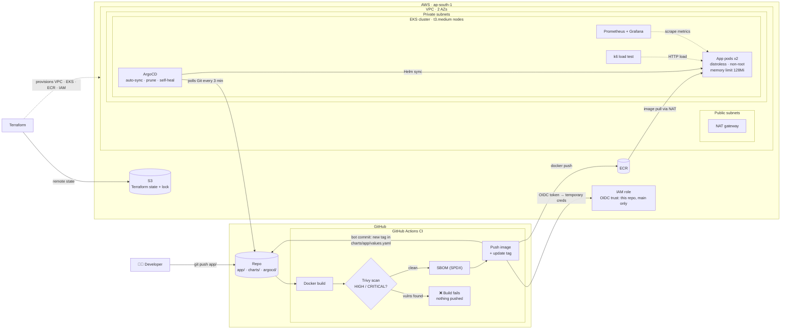
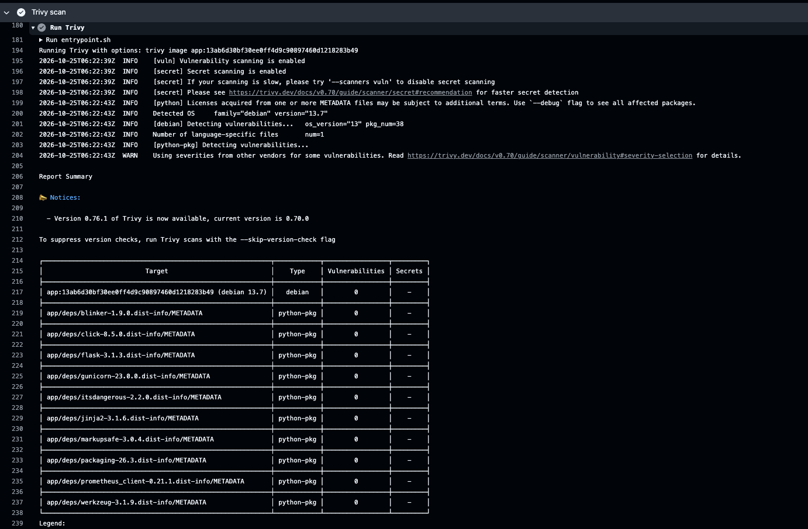
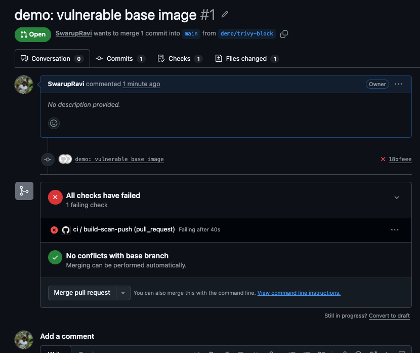
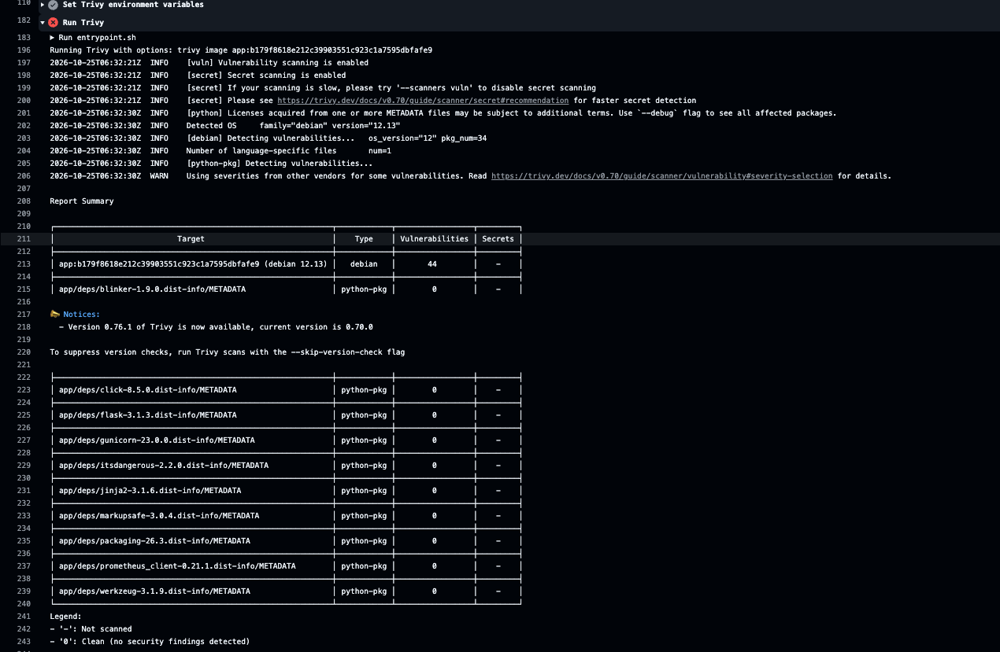
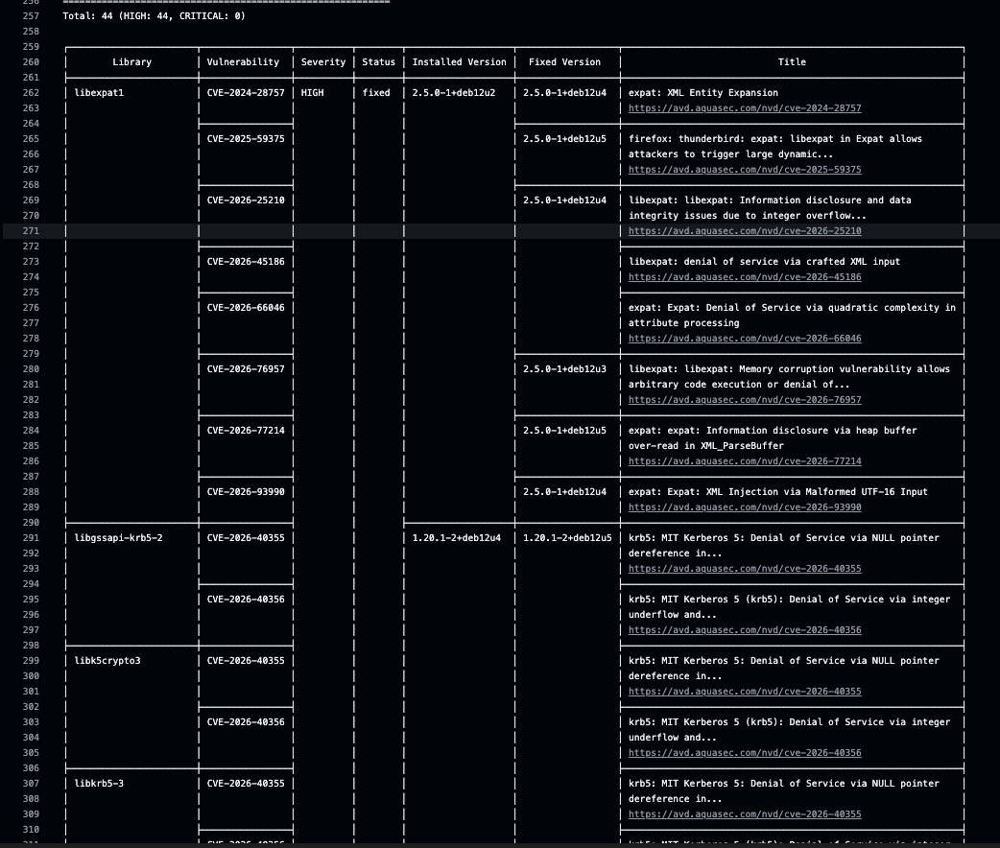
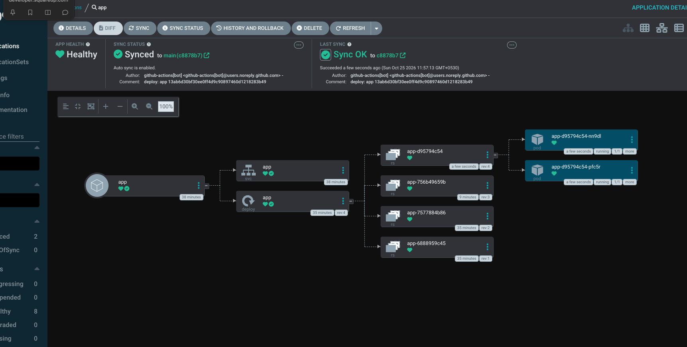
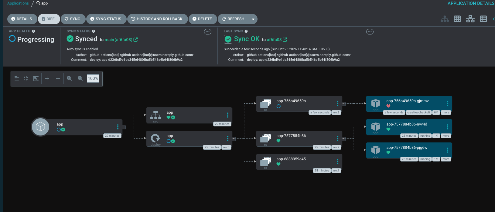
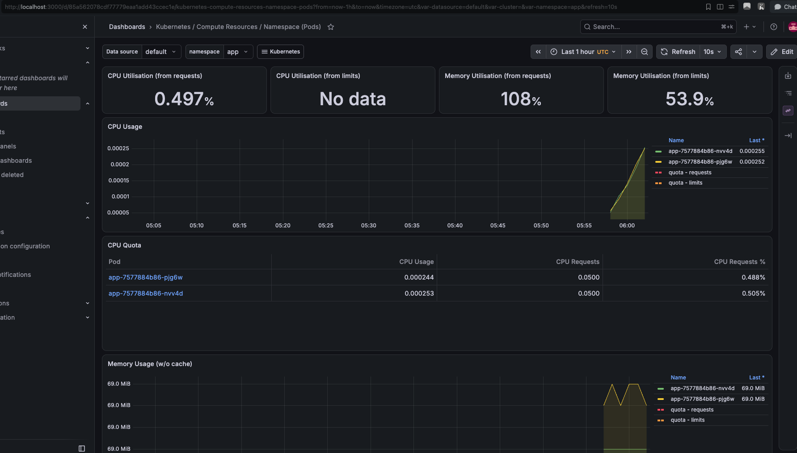
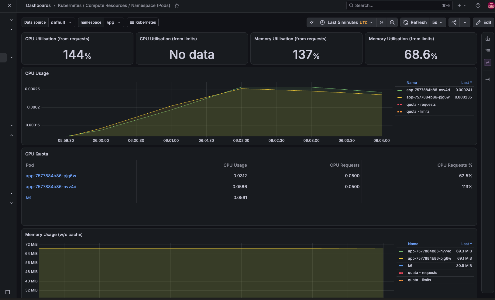

# EKS GitOps Platform

A secure delivery pipeline on AWS. Every push to `main` is built, scanned for vulnerabilities, pushed to ECR and deployed to EKS by ArgoCD. Nobody runs `kubectl apply` and no AWS keys are stored in GitHub.

## Architecture



**How it works**
1. A push under `app/` starts CI: build the image, then **Trivy** scans it. If it finds fixable HIGH/CRITICAL CVEs, the build fails and nothing is pushed.
2. A clean image gets an **SBOM** and is pushed to **ECR** using short-lived **OIDC** credentials, with no stored AWS keys.
3. CI doesn't deploy. It commits the new image tag to `charts/app/values.yaml`.
4. **ArgoCD**, running inside the cluster, sees the commit and syncs the Helm chart. Git is always the record of what's running.
5. Nodes run in **private subnets** and reach ECR and GitHub through a single NAT gateway.
6. **Prometheus + Grafana** monitor the cluster and app, and **k6** generates load from inside the cluster.

## Stack
| Layer | Tools |
|---|---|
| Infrastructure | Terraform (VPC, EKS, ECR, IAM), S3 remote state with native locking |
| CI | GitHub Actions, Trivy (pinned to commit SHA), SBOM (SPDX), OIDC auth to AWS |
| CD | Helm, ArgoCD (auto-sync, prune, self-heal) |
| Monitoring | kube-prometheus-stack (Prometheus, Grafana, Alertmanager) |
| Testing | k6 load testing, memory spike and OOMKill tests |

## Security
- **No long-lived AWS keys.** GitHub Actions assumes an IAM role through OIDC, and the trust policy only allows this repo's `main` branch.
- **Vulnerability gate.** Trivy fails the build on fixable HIGH/CRITICAL CVEs, so vulnerable images never reach ECR.
- **Supply chain.** Third-party actions are pinned to commit SHAs, and an SBOM is generated for every image.
- **Hardened container.** Distroless base image (no shell or package manager), runs as non-root UID 65532, read-only root filesystem, all Linux capabilities dropped, seccomp `RuntimeDefault`.
- **Private networking.** Worker nodes run in private subnets with no public IPs.
- **Resource limits.** Memory limits stop one bad pod from taking down the node.

## Results

### 1. Trivy security gate

**Clean image passes.** The Debian 13 distroless image has no fixable HIGH/CRITICAL CVEs, so the pipeline continues to push and deploy.



**Vulnerable image is blocked.** A PR switched the base image to `distroless/python3-debian12` (no longer patched). Trivy found **44 HIGH CVEs** (libexpat, krb5 and others) and failed the check, so the image was never pushed to ECR or deployed.





### 2. GitOps deploy with ArgoCD
CI commits the new image tag (`deploy: app <sha>`) and ArgoCD syncs it automatically. The app is **Synced** and **Healthy**, with both replicas running.



**A bad deploy did not cause downtime.** A broken build went into `CrashLoopBackOff`. Because of the rolling update and readiness probes, Kubernetes kept the old ReplicaSet's 2 pods serving traffic until a fixed commit was deployed through the same pipeline.



### 3. Load test (k6)
| Metric | Result |
|---|---|
| Requests | 368,826 |
| Throughput | ~3,073 req/s |
| p95 latency | 49.35 ms |
| Error rate | 0% |




What the dashboard showed:
- **CPU went to 144% of its request.** There is no CPU limit, so pods can use spare node CPU. CPU over a limit is throttled; it is never killed.
- **Memory was 137% of its request** (~69 MiB used against a 64Mi request) but only ~54–69% of the 128Mi limit. The request is too low and should be raised to about 96Mi so the scheduler reserves what the app really uses.

### 4. Memory spike and OOMKill test
The pod memory limit is 128Mi. The demo endpoint `/stress/memory/<mb>` allocates memory and holds it for 10 seconds.

**Memory spike demo (screen recording):** requests to `/stress/memory/<mb>` push pod memory up in Grafana, then it drops back once the request finishes.


https://github.com/user-attachments/assets/31e6fda1-e77f-410b-97ee-ad98c1e2ab63


**OOMKill:** one request to `/stress/memory/150` went over the 128Mi limit, and Kubernetes killed the container and restarted it. The second replica kept serving, so there was no downtime.

```
$ kubectl get pods -n app
NAME                  READY   STATUS    RESTARTS      AGE
app-d95794c54-nn9dl   1/1     Running   0             8m31s
app-d95794c54-pfc5r   1/1     Running   1 (56s ago)   8m45s

$ kubectl describe pod app-d95794c54-pfc5r -n app | grep -A5 "Last State"
    Last State:     Terminated
      Reason:       OOMKilled
      Exit Code:    137
      Started:      Sun, 25 Oct 2026 11:57:14 +0530
      Finished:     Sun, 25 Oct 2026 12:05:02 +0530
    Ready:          True
```

Exit code 137 = 128 + 9 (SIGKILL). The kernel kills the process immediately, so it can't write logs or a heap dump. This is why JVM heap dumps are often missing after an OOMKill.


## Problems I hit and how I fixed them
| Problem | Cause | Fix |
|---|---|---|
| `Not authorized to perform sts:AssumeRoleWithWebIdentity` | GitHub's OIDC `sub` claim now includes owner and repo IDs, and matching is case-sensitive | Found the real `sub` in CloudTrail and updated the trust policy to `owner@id/repo@id` |
| Trivy action version not found | Tags were moved after a supply-chain attack | Pinned the action to a commit SHA |
| 44 HIGH CVEs in the base image | Distroless debian12 stopped getting updates | Moved to `python3-debian13` and Python 3.13 |
| `CreateContainerConfigError` | `runAsNonRoot` can't verify a non-numeric user | Set `runAsUser: 65532` |
| ArgoCD install fails: annotation too long | ApplicationSet CRD exceeds the client-side apply annotation limit | `kubectl apply --server-side --force-conflicts` |
| `CrashLoopBackOff`, `NameError: app` | Route defined before the Flask app | Reordered `main.py`; CI and ArgoCD rolled out the fix |

## Repo layout
```
app/                 Flask app, Dockerfile (distroless, non-root)
charts/app/          Helm chart (Deployment, Service, values)
argocd/              ArgoCD Application (auto-sync, self-heal)
terraform/           VPC, EKS, ECR, GitHub OIDC role
terraform/bootstrap/ S3 bucket for Terraform state
.github/workflows/   CI: build, scan, SBOM, push, update image tag
docs/images/         Screenshots
```

## Setup
1. **State bucket:** `cd terraform/bootstrap && terraform init && terraform apply -var state_bucket_name=<unique-name>`
2. **Infrastructure:** set the bucket in `terraform/backend.tf`, copy `terraform.tfvars.example` to `terraform.tfvars` and edit it, then
   `cd terraform && terraform init && terraform apply`
3. **kubectl:** run the `configure_kubectl` output command
4. **GitHub secret:** add the `github_actions_role_arn` output as repo secret `AWS_ROLE_ARN`
5. **ArgoCD:**
   ```
   kubectl create namespace argocd
   kubectl apply -n argocd --server-side --force-conflicts -f https://raw.githubusercontent.com/argoproj/argo-cd/stable/manifests/install.yaml
   kubectl apply -f argocd/application.yaml
   ```
6. **Monitoring:**
   ```
   helm repo add prometheus-community https://prometheus-community.github.io/helm-charts
   helm install monitoring prometheus-community/kube-prometheus-stack -n monitoring --create-namespace
   ```
7. **Deploy:** push a change under `app/` to `main`. If the cluster was rebuilt, ECR was rebuilt too, so run the workflow again from the Actions tab.

## Teardown
EKS and the NAT gateway bill by the hour.
```
helm uninstall monitoring -n monitoring
cd terraform && terraform destroy
```
